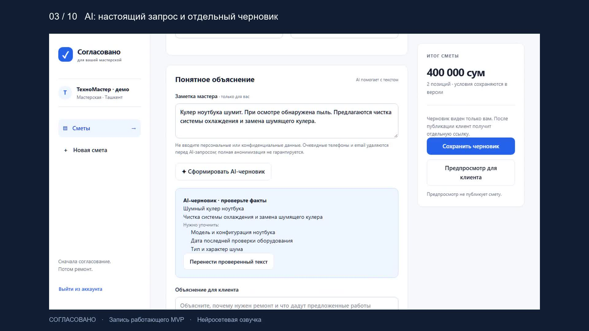
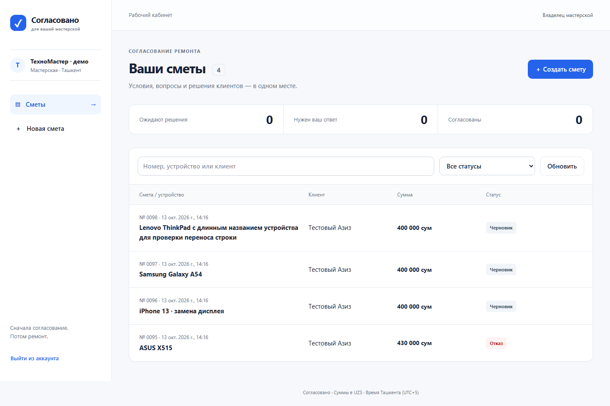
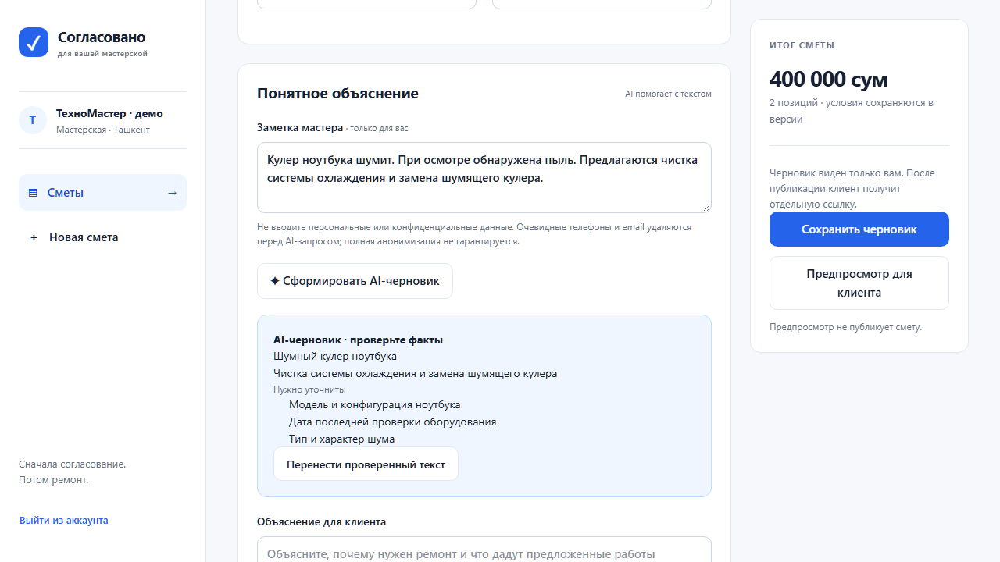

# Согласовано

**Сервис согласования ремонтной сметы для небольших мастерских по ремонту ноутбуков и телефонов в Ташкенте.**

**Проблема.** Мастер находит неисправность и озвучивает цену, но объяснение, сумма и согласие клиента остаются в устных разговорах и переписке в Telegram. Когда цена меняется или клиент спорит, восстановить, на что именно он соглашался, трудно.

**Решение.** Мастер за пару минут собирает смету: работы из своего прайса, понятное объяснение (можно с AI-черновиком), срок и гарантию. Клиент открывает ссылку без регистрации, задаёт вопрос или принимает решение. Каждая опубликованная версия неизменна: видно, какую цену и когда согласовал клиент.

**Для кого и за сколько.** Владелец мастерской на 1–5 человек, которому не нужна большая CRM. Цена-гипотеза: 199 000 сум в месяц после бесплатного двухнедельного пилота. [Продукт, конкуренты и план продаж (PDF, 2 стр.)](delivery/soglasovano-product-brief.pdf)

| Три ключевых сценария | Что проверить |
| --- | --- |
| 1. Подготовить и опубликовать смету | Каталог работ, AI-черновик с проверкой мастером, предпросмотр, печать/PDF |
| 2. Клиент спрашивает и решает по ссылке | Вопрос → ответ мастера → согласование или отказ |
| 3. Изменить цену новой версией | Старая ссылка показывает замену; прежнее решение сохраняется |

## Проверяющему: где смотреть по критериям

| Критерий ТЗ | Баллы | Доказательство |
| --- | --- | --- |
| Проблема и ценность | 20 | Описание выше, [продукт и аудитория](docs/product-brief.md) |
| Рабочий MVP | 25 | Запуск одной командой (ниже), PostgreSQL, автоматические браузерные сценарии, [запись 9:31](delivery/soglasovano-demo.mp4) |
| AI и самостоятельность | 15 | [AI в продукте и в разработке](docs/ai-usage.md), [подбор по каталогу](docs/ai-catalog.md), [оценка на 20 случаях](docs/ai-evaluation-2026-10-15.json), [найденные и исправленные ошибки](docs/verification.md) |
| Качество и надёжность | 15 | TypeScript, ESLint, 55 unit-, 13 интеграционных и браузерные тесты, CI, изоляция данных, [резервное восстановление](docs/backup.md) |
| Коммерческий потенциал | 15 | [3 конкурента, цена, пилот](docs/product-brief.md), [первые кандидаты и текст обращения](docs/first-sales.md) |
| Коммуникация и защита | 10 | [Ответы на вопросы защиты](docs/defense.md), [сценарий живого показа](docs/demo-script.md), [пункт-за-пунктом с ТЗ](docs/task-compliance.md) |

Ограничения указаны прямо, без маскировки: интервью и продаж ещё не было, публичного HTTPS-адреса нет, бесплатный AI-провайдер иногда отвечает 429. При любой ошибке AI мастер работает вручную, основной сценарий от AI не зависит.

## Запуск демо (AI-ключ не нужен)

1. Скачайте репозиторий или клонируйте его: `git clone https://github.com/sty-alt/VippIProject.git`.
2. Установите **Node.js 22.22 или новее** с [официального сайта](https://nodejs.org/).
3. На Windows дважды нажмите **START-DEMO.cmd**. Docker для этого способа не нужен. В macOS/Linux с установленным Docker Compose выполните `npm run demo` в папке проекта.
4. Дождитесь первого запуска. Скрипт устанавливает зависимости, создаёт случайные секреты в `.env`, запускает PostgreSQL, применяет миграции, явно загружает вымышленные демоданные и собирает приложение. Первому запуску нужен интернет и время на загрузку зависимостей и PostgreSQL.
5. Откроется [локальное демо](http://localhost:3077). Откройте `.local/demo-credentials.json` для входа или зарегистрируйте свою мастерскую.

При повторном запуске уже работающий сервис распознаётся по своему health endpoint и открывается без второй установки. Чужое приложение на порту 3077 скрипт не останавливает. Для завершения приложения нажмите Ctrl+C в окне запуска. Данные сохраняются; базу при необходимости можно остановить отдельно по инструкции ниже. Существующий `.env` и сметы не перезаписываются. AI-ключ для демо не нужен.

### Комплект для сдачи

| Материал                                                       | Ссылка                                               |
| -------------------------------------------------------------- | ---------------------------------------------------- |
| Презентация первого этапа, 12 слайдов с заметками              | [PowerPoint](delivery/soglasovano-presentation.pptx) |
| PDF презентации первого этапа                                 | [PDF](delivery/soglasovano-presentation.pdf)         |
| Новая запись работы MVP с AI-черновиком, 9 минут 31 секунда   | [MP4](delivery/soglasovano-demo.mp4)                 |
| Продукт, конкуренты, цена и план первых продаж, 2 страницы     | [PDF](delivery/soglasovano-product-brief.pdf)        |
| Живая демонстрация на 5–10 минут                               | [Сценарий](docs/demo-script.md)                      |
| Проверки и ограничения                                         | [Отчёт](docs/verification.md)                        |

Видео от 13 октября показывает создание сметы, настоящий запрос к OpenRouter, проверку и перенос AI-текста, публикацию, вопрос, ответ, согласование и новую версию. Сессии записаны отдельно и смонтированы в десять глав с синтетической русской озвучкой; данные вымышлены. Вспомогательные функции 15 октября в запись не входят. PowerPoint/PDF слайдов — материалы первого этапа, не актуальная спецификация. Текущее состояние описано в README и отчёте. Запись дополняет обязательный живой показ кандидатом на защите. Внешнего размещения приложения нет.

[Текст озвучки и главы](docs/demo-transcript.md) · [тайминг и формат файла](delivery/demo-timing.json).



### Быстро пройти основной сценарий

Создайте смету для ASUS X515: чистка 180 000 сум, кулер 220 000 сум. Напишите объяснение, срок и гарантию, сохраните и опубликуйте. Откройте клиентскую ссылку в приватном окне, задайте вопрос, ответьте из кабинета и согласуйте ремонт. Затем создайте новую версию с ценой кулера 250 000 сум: старая ссылка покажет замену и сохранённое решение. Подробнее: [сценарий защиты](docs/demo-script.md).

### Структура и история

`src/app` содержит страницы и API, `src/components` — интерфейс, `src/lib` — правила и серверные сервисы, `prisma` — модель и миграции, `tests` — проверки. PostgreSQL хранит реальные сметы, версии, вопросы, решения и хеши публичных ссылок.

Разработка сохранена отдельными этапами: основной серверный сценарий и интерфейс; проверка и исправления версий; упрощённый запуск и комплект для сдачи. Начальный коммит удалённого репозитория сохраняется. Автоматические проверки для GitHub Actions находятся в `.github/workflows/checks.yml`; результаты внешнего CI нужно смотреть во вкладке Actions, локальные результаты перечислены в отчёте.



## Запуск с Docker

Требуются Node.js >=22.22, npm и Docker Compose. Версии библиотек зафиксированы в package-lock.json.

```powershell
npm ci
Copy-Item .env.example .env
node -e "console.log(require('crypto').randomBytes(48).toString('hex'))"
```

Вставьте полученную строку в BETTER_AUTH_SECRET в `.env`. DATABASE_URL из примера подходит для локального Docker. Для другого пароля задайте POSTGRES_PASSWORD и измените обе строки подключения. Пароль из `.env.example` предназначен только для локальной разработки. Автоматический запуск через START-DEMO.cmd или npm run demo делает эти шаги сам.

```powershell
docker compose up -d --wait
npm run db:generate
npm run db:migrate
npm run dev
```

Если вы успели применить промежуточный коммит `72f553e` с миграцией `004_service_templates`, после обновления сначала сделайте резервную копию и выполните `npx prisma migrate resolve --applied 202610150001_service_templates` только в базе, где ServiceTemplate уже создана прежней миграцией. Затем выполните обычный `npm run db:migrate`. Для нового клонирования этот шаг не требуется.

Открыть http://localhost:3077. Зарегистрируйте мастерскую. Пустой кабинет действительно пуст: демонстрационные данные не загружаются автоматически.

Production запуск:

```powershell
npm run build
npm start
```

Перед публикацией нужны HTTPS, свой BETTER_AUTH_URL, защищённая PostgreSQL, резервные копии и запрет журналирования клиентских URL в reverse proxy. Публичного развёртывания в рамках этой работы нет.

## Локальная PostgreSQL на Windows без Docker

В текущем рабочем окружении Docker отсутствует. Подготовлен отдельный PostgreSQL 17 в игнорируемой папке `.local`. Скрипт создаёт отдельный кластер и случайные локальные пароли; не использует существующие базы компьютера.

```powershell
npm ci
powershell -ExecutionPolicy Bypass -File scripts/local-postgres.ps1
npm run db:generate
npm run db:migrate
npm run dev
```

Для остановки:

```powershell
powershell -ExecutionPolicy Bypass -File scripts/local-postgres.ps1 -Stop
```

Данные сохраняются в `.local/pg-data`. Повторный запуск не переинициализирует кластер. Не удаляйте эту папку, если нужны данные. В Docker используется volume `postgres_data`; `docker compose down` сохраняет его, а `down -v` удаляет — последнюю команду для обычной остановки не применяйте.

## Демоданные — только явное действие

```powershell
npm run db:seed
```

Создаёт вымышленную мастерскую и четыре сметы: ожидающую ответа, согласованную, с вопросом и черновик. Логин и случайный пароль записываются в `.local/demo-credentials.json`, который исключён из Git. Можно заранее задать DEMO_EMAIL и DEMO_PASSWORD через окружение. Повторный запуск не перезаписывает существующие сметы. Для открытия клиентской страницы войдите, откройте действующую смету и перевыпустите ссылку.

## AI

В редактор добавлен [AI-подбор работ из собственного каталога](docs/ai-catalog.md): заметка мастера → сохранённые позиции с цитатами-основаниями → объяснение и уточнения → проверка и перенос в форму. Цены и количество берутся из БД. Сначала заполните «Мои работы и цены». Успешность новой функции с живой моделью пока не подтверждена: пробный запрос получил HTTP 429; логика проверена тестовым HTTP-сервером, PostgreSQL и браузером.

В `.env` задаются только на сервере:

```dotenv
AI_API_KEY=
AI_BASE_URL=https://openrouter.ai/api/v1
AI_MODEL=liquid/lfm-2.5-2.6b:free
AI_ALLOW_PAID_MODELS=false
```

Нужен OpenAI-совместимый `POST /chat/completions` с JSON-ответом. Ключ и модель не поставляются с проектом. Перезапустите приложение после настройки. Если настройки отсутствуют, интерфейс показывает ручной режим, а сервер возвращает понятную ошибку. HTTP-адаптер проверен локальным тестовым HTTP-сервером с валидными ответами, ошибками и неверной схемой.

Для OpenRouter задайте `AI_BASE_URL=https://openrouter.ai/api/v1`, свой `AI_API_KEY` и `AI_MODEL=liquid/lfm-2.5-2.6b:free`. Адаптер отправляет точную JSON-схему и дополнительно проверяет ответ на сервере. 13 октября 2026 эта модель вернула валидное объяснение вымышленной заметки через адаптер приложения. Это проверка подключения, а не полный аудит качества. Бесплатные модели могут быть недоступны или ограничены; каталог и условия меняются. Проверка мастером обязательна. Настройки с ключом храните только в исключённом из Git `.env`. Контракт: [OpenRouter API](https://openrouter.ai/docs/api_reference/overview).



После проверки мастер отдельно переносит текст и может его исправить: [снимок после переноса и правки](delivery/ai-reviewed.png). Вторая версия видео показывает эти действия и реальный запрос к модели.

AI получает заметку и названия работ. Отдельные имя клиента, цены, количество, сроки и гарантия не передаются. Очевидные телефоны, email и денежные фрагменты заметки удаляются; произвольный текст всё равно может содержать персональные данные. Полная анонимизация не гарантируется. AI-черновик показывается отдельно и переносится только после проверки мастером. Схема и запрет числовых условий не гарантируют достоверность текста.

15 октября выполнен [набор из 20 вымышленных случаев](docs/ai-evaluation-2026-10-15.json): в финальном прогоне 16 ответов прошли автоматическую проверку, один отклонён, три запроса ограничены провайдером. Это не оценка точности 80%: качество формулировок и факты требуют проверки мастером. Для reasoning-моделей OpenRouter задан общий лимит 3000 токенов, минимальные рассуждения и исключение их из ответа. Числовые условия, явные обещания и утверждения о выполнении предлагаемых работ дополнительно фильтруются. Ручной режим доступен при любой ошибке. Изменение заметки/названий работ блокирует перенос старого ответа.

```powershell
npm run ai:evaluate
```

Эта отдельная команда отправляет до 20 реальных запросов, требует настроенный ключ и модель с суффиксом `:free`; она не запускается в CI. Условия и лимиты бесплатного провайдера могут измениться. Локальный отчёт создаётся в `.local/evaluations`.

### Расходы на AI

Платные внешние AI-модели по умолчанию блокируются до HTTP-запроса. Бесплатные модели OpenRouter с суффиксом `:free` и локальные endpoints разрешены. `AI_ALLOW_PAID_MODELS=true` снимает блокировку; включать только после предварительного согласования расходов, как требует задание. Флаг сам по себе не заменяет согласование. Условия бесплатного провайдера нужно проверять отдельно.

## Работы, восстановление и документы

В «Мои работы и цены» сохраняйте свои повторяющиеся позиции, затем выбирайте их в редакторе. Изменения каталога не меняют существующие сметы. После случайной перезагрузки редактор предложит восстановить ввод в той же вкладке; только «Сохранить черновик» записывает его на сервер. «Печать / PDF» печатает выбранную версию без внутренней заметки. В диалоге браузера отключите колонтитулы с URL перед передачей документа клиенту.

```powershell
npm run db:backup
npm run db:verify-restore
```

Архивы остаются в исключённой из Git `.local/backups`. Проверка восстановления использует отдельную временную локальную базу и сравнивает данные всех таблиц, сохраняя рабочую базу. [Требования, ручное восстановление и ограничения](docs/backup.md).

## Проверки

Переменные окружения (серверные, вне Git):

| Переменная | Назначение |
| --- | --- |
| DATABASE_URL | Рабочая PostgreSQL |
| TEST_DATABASE_URL | Отдельная локальная база `_test`, только для проверок |
| BETTER_AUTH_SECRET | Случайный секрет сессий, минимум 32 символа |
| BETTER_AUTH_URL | Адрес приложения, для локального запуска http://localhost:3077 |
| AI_API_KEY / AI_BASE_URL / AI_MODEL | Необязательные ключ, адрес и модель AI; без них работает ручной сценарий |
| AI_ALLOW_PAID_MODELS | По умолчанию false; true только после согласования расходов |
| POSTGRES_PASSWORD | Пароль Docker PostgreSQL, должен совпадать с DATABASE_URL |
| DEMO_EMAIL / DEMO_PASSWORD | Необязательное явное переопределение демонстрационного входа при seed |

```powershell
npm run typecheck
npm run lint
npm test
npm run test:integration
npm run build
npx playwright install chromium
npm run test:e2e
```

Интеграционные и браузерные проверки используют TEST_DATABASE_URL, отдельную локальную базу с суффиксом `_test`. Она должна отличаться по имени от рабочей. Команды отказываются работать с другим адресом и не выполняют DROP/TRUNCATE. Тесты удаляют только аккаунты, созданные текущим прогоном. Для Docker базу нужно создать явно:

```powershell
docker compose exec db createdb -U soglasovano soglasovano_test
```

Если база уже существует, повторять createdb не нужно. E2E запускает production build на 3078 и требует свободный порт; рабочий сервер на 3077 использует другую базу. Сначала выполните build. E2E проверяет регистрацию, ручную смету без AI, предпросмотр, публикацию, согласование, новую версию, вопрос, ответ, отказ, поиск, вход/выход, ошибки и ширины 390/768/1440. Снимки находятся в `test-results/screenshots`; токены не пишутся в названия файлов, trace выключен.

## Ограничения

- Один владелец на мастерскую. Нет подтверждения email и восстановления пароля; неработающих кнопок для них нет.
- Ссылка подтверждает ответ держателя, а не личность и не квалифицированную подпись.
- Нет автоматической отправки в Telegram, платежей, склада, CRM и диагностики.
- Лимиты собственных API хранятся в PostgreSQL и общие для процессов: вход — по email и глобально, AI — по мастерской, ответы — по хешу ссылки. Внутренний дополнительный лимит Better Auth действует в памяти процесса. Нет WAF и защиты от крупномасштабных атак; при продакшене нужны ограничения на прокси. Истёкшие записи Throttle можно периодически удалять средствами эксплуатации.
- Кабинет обновляется по кнопке/перезагрузке, без push. Список без пагинации, рассчитан на небольшой пилот.
- Ввод временно копируется в sessionStorage той же вкладки на 24 часа и восстанавливается по кнопке. Это не серверное сохранение: закрытие вкладки, очистка или запрет хранилища могут удалить копию; при выходе из аккаунта она очищается.
- Native подтверждения и предпросмотр подходят MVP; расширенный аудит доступности не проводился.
- В dev-зависимостях остаётся непатченое предупреждение `braces` через ESLint/fast-glob; runtime audit проверяется отдельно. Не применять audit fix --force с понижением Next/Prisma.
- Docker Compose подготовлен, но не выполнялся на этой машине; функциональные проверки используют настоящую локальную PostgreSQL.

## Материалы для сдачи

- [Соответствие исходному тестовому заданию](docs/task-compliance.md)
- [Подготовка к живой защите](docs/defense.md)
- [Кандидаты на первый пилот и план обращения](docs/first-sales.md)

- [Продукт и конкуренты](docs/product-brief.md)
- [Сценарий защиты](docs/demo-script.md)
- [Архитектура](docs/architecture.md)
- [Использование AI](docs/ai-usage.md)
- [Библиотеки и лицензии](docs/licenses.md)
- [Результаты проверки](docs/verification.md)
- [Готовность к защите и первым продажам](docs/readiness.md)
