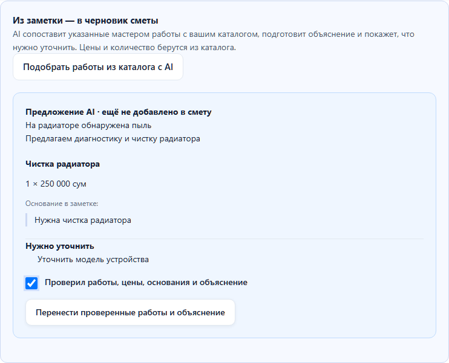

# AI для подготовки сметы

15 октября 2026 добавлен сценарий «Заметка → работы из каталога → проверенный черновик». Цель — сократить ручной подбор повторяющихся позиций. Экономия времени пока не измерена на реальных мастерских.

## Как попробовать

1. В «Мои работы и цены» добавьте свои позиции с ценами мастерской.
2. Откройте новую смету. В заметке укажите обнаруженные факты и решение мастера: «На радиаторе обнаружена пыль. Нужна чистка радиатора».
3. Нажмите «Подобрать работы из каталога с AI».
4. Проверьте позиции, цитаты-основания, цены, объяснение и уточнения. Поставьте отметку проверки и перенесите результат в форму.
5. Отредактируйте форму при необходимости, задайте срок и гарантию, сохраните и опубликуйте обычным способом.

Модель получает заметку, названия уже введённых работ и до 100 названий каталога с техническими ID. Каталог выбирается сервером по сессии владельца; клиентский каталог не принимается. Цены, количество, отдельные имя клиента/устройство, сроки и гарантия в запрос не входят. Удаление очевидных телефонов/email не гарантирует полной анонимизации свободного текста.

## Проверка результата

- Модель возвращает ID работ, точные цитаты из заметки и текст. Схема запрещает цену или количество в выборе.
- Сервер проверяет ID по каталогу мастерской, повторы и наличие цитаты в очищенной заметке; подставляет цену, количество и название из БД. AI не записывает смету.
- Изменение заметки или названий работ делает предложение устаревшим. Для переноса нужны новая генерация и отметка проверки.
- Перед переносом браузер получает актуальный каталог. Смена цены, названия, количества или удаление позиции блокируют перенос. Изменение формы во время этого запроса тоже блокирует перенос.
- Введённые вручную позиции и их цены сохраняются. Работы не дублируются; ограничения сметы проверяются повторно. Существующее объяснение заменяется после отдельного подтверждения.
- Перенос не сохраняет и не публикует смету.

Цитата подтверждает происхождение текста, но не смысловую правильность выбора. По одному симптому AI не должен назначать замену детали: это указано в инструкции, однако фильтр не гарантирует отсутствие диагностических выдумок. Мастер проверяет соответствие работы своему решению. Если подходящих работ нет, показываются уточнения. Старое формирование объяснения по вручную введённым работам сохранено.

## Что проверено

Локальный HTTP-сервер с тестовым ответом проверяет транспорт, валидацию и отсутствие цен в запросе. PostgreSQL-тест подтверждает изоляцию каталога и отказ для чужого ID. Браузерный тест с явно подставленным ответом проверяет подтверждение, устаревание, смену цены, изменение формы во время запроса и сохранение ручной цены. Эти тесты не доказывают качество внешней модели.

Один реальный запрос к `liquid/lfm-2.5-2.6b:free` для нового сценария получил HTTP 429. Дальнейшие запросы не повторялись. Успешная живая генерация именно этого подбора пока не подтверждена. Предыдущий набор из 20 примеров относится к прежнему текстовому объяснению.

Оба AI-действия используют один адаптер, timeout 15 секунд, ограничение размера ответа, строгую схему и общий лимит мастерской. При ошибке доступен ручной сценарий. Для эксплуатации нужно выбрать доступную модель и проверить подбор на отдельном наборе реальных обезличенных случаев; настроенный бесплатный провайдер сейчас ограничивает запросы.

